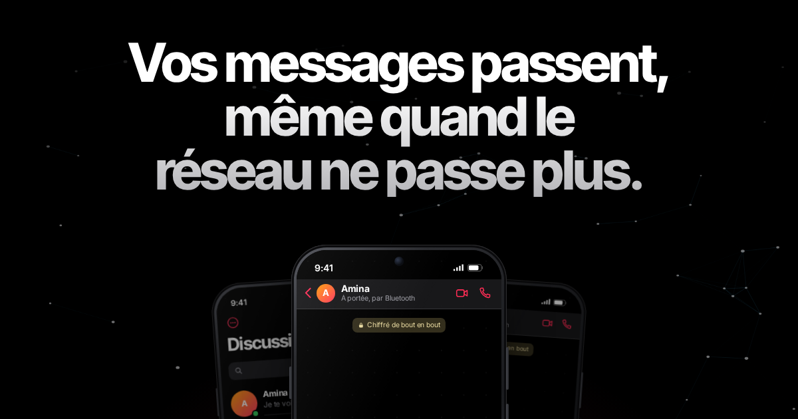
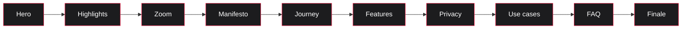

<div align="center">


# dropletmesh.app

**The official website of Droplet — messaging without internet.**


[**Visit dropletmesh.app**](https://dropletmesh.app) &nbsp;·&nbsp; [**Security**](https://dropletmesh.app/security/) &nbsp;·&nbsp; [**Support**](https://dropletmesh.app/support/) &nbsp;·&nbsp; [**The app**](https://github.com/rito27959-arch/droplet)

<br>



</div>

<br>

## Overview

A static [Astro](https://astro.build) site in ten languages — French at the root, the others under `/en/`, `/de/`, `/ar/`… Every phone screen on the page is drawn in HTML, so it stays sharp at any size and is translated like the rest of the copy.

## The page, section by section



| Component | What it does |
|:--|:--|
| `Hero` | The headline and three phones that spread apart as you scroll |
| `Galerie` | The *Highlights* carousel |
| `Zoom` | A screen that pulls back to reveal the phones around it |
| `Manifeste` | Copy that lights up word by word |
| `Parcours` | A message travelling relay to relay |
| `Fonctions`, `Confidentialite`, `Usages`, `Questions`, `Fin` | Features, privacy, use cases, FAQ and closing |
| `Appareil`, `Ecran` | The phone and app screens, drawn in HTML |

## Craft

- **Theme colour chosen by the visitor** — eight hues, the same as in the app, from the swatch in the top bar or under the opening phones. Everything derives from `--goutte` (`src/styles/global.css`); the choice is remembered and applied before first paint.
- **Motion with manners** — the top mesh pauses off-screen and in hidden tabs; the carousel only moves while visible and stops on touch; *Reduce motion* freezes everything.
- **Privacy by construction** — fonts are served by the site itself: no request to Google, no cookies, no analytics.
- **Invitation links** — `/i/#…` receives the links the app creates. Everything that identifies the inviter sits after the `#`: the browser never sends it to the server; the page reads it on the guest's phone and opens `droplet://droplet/invite?d=…`.

## Documents

| Page | French | Other languages |
|:--|:--|:--|
| Support | `/support/` | all ten languages |
| Security | `/security/` | all ten languages |
| Privacy | `/privacy/` | French and English; other languages show English with an explanatory banner |
| Terms and legal notice | `/terms/` | same as Privacy |

Text lives in `src/docs/<lang>.ts` (French is the reference). After any change, `node --experimental-strip-types outils/verif_docs.mjs <lang>` checks that a translation has the same structure as the French.

## Develop

Node.js 20 or later.

```bash
npm install
npm run dev        # http://localhost:4321, live reload
npm run build      # dist/
npm run preview    # check dist/ before publishing
```

All copy lives in `src/i18n/`, one language per file; `fr.ts` is the reference and TypeScript refuses to build if a key is missing elsewhere.

## Deployment

Live at **[dropletmesh.app](https://dropletmesh.app)**, published by Vercel on every push to `main`. `vercel.json` also redirects `/droplet.apk` to the latest GitHub release.

<br>

<div align="center">
<sub>
<a href="https://dropletmesh.app">Droplet</a> &nbsp;·&nbsp;
<a href="https://dropletid.dropletmesh.app">Droplet ID</a> &nbsp;·&nbsp;
<a href="https://drop.dropletmesh.app">Droplet Drop</a> &nbsp;·&nbsp;
<a href="https://web.dropletmesh.app">Droplet Web</a>
<br><br>
Designed and built in Yaoundé, Cameroon.
</sub>
</div>
